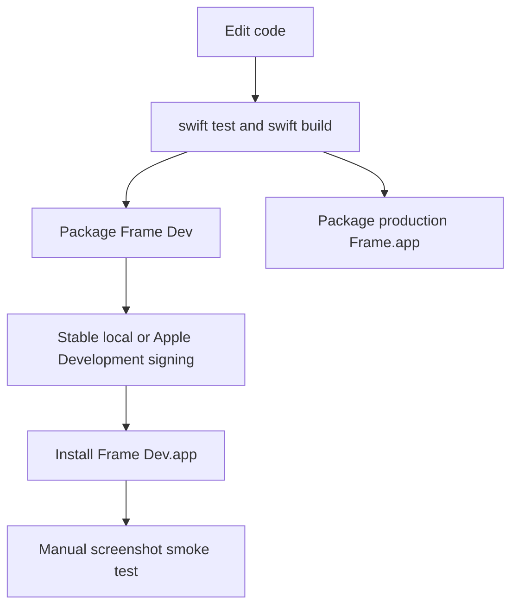

# Development



Frame development uses SwiftPM for verification, a local packaging script for app bundle creation, and a stable local signing path for repeat GUI testing without unnecessary Screen Recording permission churn.

## Requirements

- macOS 26 or later
- Swift 6.2 toolchain
- Xcode command line tools with the macOS 26 SDK or later
- Apple Developer Program membership only for Apple Development and public distribution signing

## Verify

Run these before merging or opening a PR:

```sh
swift test
swift build
scripts/package-app.sh
```

`scripts/package-app.sh` writes `Info.plist`, copies the release executable, and signs the bundle. It uses ad-hoc signing by default so CI and fresh machines work without account setup.

## App Variants

The packaging script owns the registered app identity mapping. Callers select a variant instead of entering bundle identifiers manually:

| Variant | App name | Bundle identifier | Output |
| --- | --- | --- | --- |
| `production` (default) | Frame | `dev.deweyou.frame` | `.build/app/Frame.app` |
| `development` | Frame Dev | `dev.deweyou.frame.dev` | `.build/app/Frame Dev.app` |

Inspect the resolved configuration without building:

```sh
scripts/package-app.sh --print-configuration
FRAME_APP_VARIANT=development scripts/package-app.sh --print-configuration
```

The release tooling always requests the `production` variant, even if the calling shell has another `FRAME_APP_VARIANT` value.

The different bundle identifiers isolate `UserDefaults` and macOS TCC permissions. Capture history is also isolated: production keeps the existing `Application Support/Frame/History` location, while development uses `Application Support/Frame Dev/History`.

The packaging script also copies app resources from `Sources/FrameApp/Resources` into the app bundle. `Frame.icns` is written to `Contents/Resources` and referenced by `CFBundleIconFile`; menu bar PNG assets are copied so `StatusItemController` can load `FrameStatusIconTemplate` as a template image.

For local GUI testing, sign the development variant with the exact Apple
Development identity listed by `security find-identity -v -p codesigning`.
See the [local installation flow](#manual-smoke-test) and
[signing setup for a new Mac](signing-and-device-migration.md#set-up-a-new-development-mac).

## Manual Beta Release

Frame's first release path is a manual beta download. It produces a DMG, a ZIP,
and SHA-256 checksums, but it does not notarize the app and does not configure
automatic updates.

### GitHub Actions

Use the `Manual Release` workflow from the GitHub Actions UI for the normal beta
release path. It is triggered manually with `workflow_dispatch` and asks for:

- `version_bump`: `patch`, `minor`, `major`, or `custom`.
- `custom_version`: required only when `version_bump` is `custom`.
- `create_github_release`: whether to create a GitHub Release after packaging.

The workflow runs `scripts/prepare-release-version.sh`, which computes the next
semantic version from `Sources/FrameCore/FrameVersion.swift`, increments the
build number by one, and delegates the actual file updates to
`scripts/bump-version.sh`.

After the version is prepared, the workflow runs tests, builds, creates release
artifacts, verifies checksums and the DMG, commits the version/changelog changes,
tags `v<version>`, pushes the commit and tag, and uploads the DMG, ZIP, and
`SHA256SUMS` as workflow artifacts. If `create_github_release` is enabled, it
also creates a GitHub Release with the same files and release notes extracted
from `CHANGELOG.md`.

### Local Release

Before bumping the version, write user-facing release notes under
`CHANGELOG.md`'s `Unreleased` section. Then run:

```sh
scripts/bump-version.sh 0.2.0 2
```

The first argument is `CFBundleShortVersionString`, and the second argument is
`CFBundleVersion`. The build number must be a positive integer greater than the
current build.

To use the same bump choices as GitHub Actions locally, run:

```sh
scripts/prepare-release-version.sh patch
scripts/prepare-release-version.sh minor
scripts/prepare-release-version.sh major
scripts/prepare-release-version.sh custom 0.2.0
```

Verify the app before creating downloadable artifacts:

```sh
swift test
swift build
scripts/package-app.sh
```

Create release artifacts:

```sh
scripts/package-release.sh
```

The output is written to:

```text
.build/release/Frame-<version>-build.<build>/
```

The directory contains:

- `Frame-<version>-build.<build>.zip`
- `Frame-<version>-build.<build>.dmg`
- `SHA256SUMS`

Use `FRAME_RELEASE_CODESIGN_IDENTITY` when intentionally testing a release
signing identity:

```sh
FRAME_RELEASE_CODESIGN_IDENTITY="Frame Beta Release" scripts/package-release.sh
```

If no release identity is supplied, `scripts/package-release.sh` falls back to
the existing ad-hoc package behavior and prints a warning. Without Developer ID
signing and notarization, public beta users should be told to copy `Frame.app`
to `/Applications`, open it from there, use macOS `Open Anyway` when prompted,
grant Screen Recording permission, and relaunch the app. Do not ask users to run
Frame directly from the mounted DMG.

## Manual Smoke Test

1. Choose an Apple Development signing identity from
   `security find-identity -v -p codesigning`, then package the development build:

   ```sh
   FRAME_APP_VARIANT=development \
   FRAME_CODESIGN_IDENTITY="Apple Development: Your Name (IDENTIFIER)" \
   scripts/package-app.sh
   ```

2. Quit the installed Frame Dev, replace it at `~/Applications/Frame Dev.app`,
   then verify the signature before opening it:

   ```sh
   mkdir -p "$HOME/Applications"
   frame_previous=$(mktemp -d "$HOME/Applications/.frame-update.XXXXXXXX")
   if [ -d "$HOME/Applications/Frame Dev.app" ]; then
       mv "$HOME/Applications/Frame Dev.app" "$frame_previous/Frame Dev.app"
   fi
   ditto ".build/app/Frame Dev.app" "$HOME/Applications/Frame Dev.app"
   codesign --verify --strict --deep "$HOME/Applications/Frame Dev.app"
   codesign -dv --verbose=4 "$HOME/Applications/Frame Dev.app" 2>&1
   open "$HOME/Applications/Frame Dev.app"
   ```

   Check for an Apple Development authority, a Team ID, and
   `Identifier=dev.deweyou.frame.dev`. The directory in `frame_previous`
   holds the previous bundle for rollback.

3. Grant Screen Recording permission when prompted.
4. Quit and reopen `~/Applications/Frame Dev.app`.
5. Open `Frame -> 设置...` / `Frame -> Settings...`. Switch among General, Capture, History, and Permissions and confirm the controls match the selected pane. Reopen Settings from another display and confirm it centers on that display.
6. Change the language between Follow System, 中文, and English. Confirm the menu, settings window labels, permission alerts opened after the change, Quick Access tooltips, and capture placeholder use the selected language. In General, turn Launch at Login on and confirm Frame appears under System Settings > General > Login Items & Extensions; turn it off and confirm the login item is removed. If macOS reports that approval is required, confirm Settings explains where to approve it. In Permissions, verify that granted rows show a checkmark and missing rows link to the matching macOS settings pane. Return to Frame from System Settings and confirm the states refresh. With a dedicated test app that lacks optional access, verify that automatic scrolling offers Settings and allows manual scrolling, and that recording can start with keystroke hints disabled.
7. In General, switch between the Light, Dark, and Follow System appearance previews. Confirm the Settings window updates immediately and both screenshot HUD capsules, icons, dimensions, and tooltips remain readable over light and dark content. Quit and reopen Frame to confirm the choice persists. Also verify that a custom screenshot save folder persists.
8. In Settings, change Window screenshot style between Soft Backdrop, Canvas Glow, Transparent Shadow, and Original. Change Edited screenshot save between Ask Every Time, Replace Current, and Save As New. Confirm the labels localize and the selected values persist after reopening Settings.
9. Reset the screenshot save folder and confirm it returns to Desktop.
10. Confirm the menu has separate Capture Screenshot and Record Screen items, displays configured shortcuts, and keeps Record Screen available when its shortcut is unset. Start each flow from its menu item or configured keyboard shortcut.
    In the shortcut recorder, try a single modifier, a duplicate Frame shortcut,
    an enabled macOS shortcut, and a common app shortcut such as Command+A.
    Confirm that dismissing a conflict or warning preserves the saved shortcut.
11. With no previous selection, confirm the active display shows a centered placeholder instead of a `0 x 0` HUD. After confirming a window capture, quit and reopen Frame, then start capture again within ten minutes. Confirm the same live window restores as the initial selection without hover preselection, even after moving the window. After confirming a region capture, reopen the overlay and confirm the same rectangle restores without hover preselection. A full-screen capture, closing a remembered window, or waiting for expiry returns to the empty state.
12. Drag to create, move, or resize the region.
13. Press Enter to capture.
14. Confirm the `180x120` preview appears at the active screen's bottom-left corner with equal left and bottom padding.
15. With multiple displays, switch to another app on a different display and confirm visible previews move to that display's bottom-left corner.
16. Take multiple screenshots and confirm previews stack upward from the bottom-left corner.
17. Confirm the Quick Access preview cannot be moved by dragging its background.
18. Drag the preview image into a rich-text TextEdit document or Notes note and confirm the target receives image content.
19. Hover the preview and confirm icon-only save, copy, workspace, pin, and close actions appear in a stable deep-glass action overlay while the captured pixels stay unchanged. Confirm the close control and OCR status use the same dark accessory treatment.
20. Confirm copy places an image on the pasteboard.
21. Confirm save writes `Frame yyyy-MM-dd HH.mm.ss.png` to the configured screenshot folder, or Desktop after reset.
22. Double-click an eligible app window, capture it, and confirm the output uses the selected window screenshot style. Confirm Original keeps the cropped raw window output without an added background canvas while region screenshots remain undecorated.
23. Confirm the workspace action opens a movable, resizable preview/edit workspace.
24. Resize the workspace and confirm the image preview area preserves the captured image aspect ratio with an opaque black canvas behind any unused area. Open screenshots that fit on screen and confirm the preview/edit and pinned windows start near the image's original display size instead of the old small cap. Open a small screenshot and confirm the displayed image starts at its original size instead of being enlarged to fill the window. Pinch on the trackpad inside the preview/edit workspace and pinned window; the image content should zoom in and out while the window frame stays fixed. After zooming in, two-finger scroll across the preview and confirm the enlarged image pans to other areas without revealing blank space.
25. Confirm switching focus to another app does not close the preview/edit workspace.
26. Click the same Quick Access workspace action again and confirm it activates the existing preview/edit workspace instead of opening a duplicate.
27. Confirm the top toolbar shows Select, Rectangle, Oval, Line, Arrow, Brush, Text, Highlight, Mosaic, the contextual header style control, Save Current, Copy, and Download. Confirm the stable dark glass remains readable above bright and saturated captured pixels, History / Tools / Contextual Style / Output are separated by quiet short dividers, and the selected tool uses a compact accent circle with a light glyph. Confirm the header style control appears only when the selected object or active tool supports color and contextual size edits, replaces the old separate Color and Thickness/Font Size toolbar menu buttons, and is absent from pinned image-only windows. The Select tool should be active by default; the header style control and its divider should be hidden until a drawable style context is active. Change color, thickness, font size, shape, and mosaic mode from the toolbar, reopen the workspace, and confirm those choices are remembered while Select is still active by default.
28. Confirm Save Current is disabled before edits, while Copy and Download are enabled. The three output controls should use equal button sizes with compact group spacing; their icons should share the same visual box and centerline as the main tools. Copy and Download tooltips should say Save and Copy / Save and Download.
29. Click each editing tool's main icon and confirm it activates the tool without opening an option menu.
30. Confirm only Mosaic has an attached chevron dropdown with a comfortable target, and that it contains Region/Brush mosaic modes. Its primary action and chevron should read as one compact split control with a shared hover/selected state and an inner divider. Shape, Brush, Text, and Highlight should not expose tool-option chevrons. Confirm the header style control color swatch has no visible chevron and opens a tiled icon-only palette. Selecting Shape, Brush, or Highlight should switch the header style control size slider to Thickness with 1, 2, 4, 8, 12, 16, and 24 px stroke widths, while selecting Text should switch it to Font Size with 12 through 96 pt options. Confirm the control does not show the selected size as visible text.
31. Draw a rectangle, oval, line, arrow, brush stroke, highlight stroke, text label, rectangle mosaic, and brush mosaic; confirm the drawn content stays on the captured image. Hold Shift while drawing rectangle/oval and confirm square/circle output; hold Shift while drawing line/arrow and confirm horizontal, vertical, or 45-degree snapping. Rectangle mosaic should show only a selection frame while dragging and apply pixelation after release.
32. Select an edited object, move it, resize it from its top-right corner without a visible anchor, delete it, undo, and redo. Confirm Undo and Redo are disabled when their history stacks are empty.
33. Re-select a text label, edit the text, then change Font Size while the text is selected and confirm the selected text updates immediately.
34. Confirm `V`, `R`, `O`, `L`, `A`, `B`, `T`, `H`, and `M` switch Select, Rectangle, Oval, Line, Arrow, Brush, Text, Highlight, and Mosaic while the canvas is focused. Confirm `[` and `]` step the current contextual size, and that normal typing plus Command-A/C/X/V still works inside an inline text editor.
35. Confirm single-clicking existing annotations can select and move them without first switching to Select. Double-click text, arrow, rectangle, oval, line, brush, highlight, and mosaic objects and confirm the toolbar and header style control enter the matching editing context.
36. Confirm Save Current becomes enabled after an edit and follows the Edited screenshot save setting. Ask Every Time should open Replace Current / Save As New choices; Replace Current should update the current in-memory screenshot, refresh the still-visible Quick Access preview, clear the pending annotation selection, and keep the workspace open; Save As New should add another Quick Access preview and keep the workspace open without writing a local file directly.
37. Confirm workspace Copy includes rendered edits, then closes the workspace and the originating Quick Access preview on success.
38. Confirm workspace Download writes a rendered edited `Frame yyyy-MM-dd HH.mm.ss.png` to the configured screenshot folder, then closes the workspace and originating Quick Access preview on success.
39. With Replace Current or Save As New configured, confirm Escape or the native close button asks only Save, Don't Save, or Cancel when unsaved edits exist, and that Save follows the configured default. Confirm Ask Every Time intentionally retains Replace Current / Save As New choices. Don't Save closes without creating or replacing a screenshot; Cancel leaves the workspace open with edits intact.
40. Confirm pin closes the originating Quick Access card and opens a persistent image-only pinned window.
41. Confirm the pinned window has no toolbar or visible output buttons, keeps the image edge-to-edge, stays open after focus changes, and closes with the native red traffic-light close button.
42. Right-click the pinned window and confirm Copy and Download work without closing it.
43. Right-click the pinned window and confirm Edit opens or activates the preview/edit workspace without closing the pinned window.
44. Use the screenshot shortcut again, draw a region, click the recording HUD button, and confirm the HUD switches into recording setup without closing the overlay.
45. Record a short MP4 with cursor enabled. Confirm start shows a brief preparation/loading state instead of a countdown, then switches to elapsed-time recording controls; stop finalizes the file, restart discards the current take and records the same area again, and delete requires confirmation before discarding without Quick Access.
46. Confirm the menu bar icon becomes a red recording dot while recording and its Stop Recording menu item stops the same active session.
47. Confirm the completed recording appears in a bottom-left Quick Access card with Download, Copy, Preview, disabled Edit, and Close.
48. Confirm Preview opens a playable video window and Edit remains disabled. For an MP4, confirm the traffic-light-safe output header uses a dark compact Save Current / Copy / Download group with centered light icons, and the timeline editor uses a deeper workbench background with light playback, time, and speed controls.
49. Confirm Copy places the recording file URL on the pasteboard and Download writes `Frame yyyy-MM-dd HH.mm.ss.mp4` to the configured screenshot folder.
50. Repeat with GIF selected and confirm `Frame yyyy-MM-dd HH.mm.ss.gif` output is produced.
51. Select an entire single display as the recording region and confirm the recording HUD remains usable but is absent from the output.
52. Confirm local capture history lists recordings separately, opens playable recording files, copies file URLs, saves files, and deletes cached recording records.

Keep using the same `FRAME_CODESIGN_IDENTITY`, the `development` variant, and the same `~/Applications/Frame Dev.app` path while iterating. Changing any of them can make macOS ask for Screen Recording permission again.

## CI

GitHub Actions runs on macOS and verifies:

- AppKit component E2E with `swift test --filter HUDSizeControlTests`
- `swift test`
- `swift build`
- `scripts/package-app.sh`
- generated app bundle existence
- generated `Info.plist` validity
- generated app bundle signature metadata

CI does not grant Screen Recording permission or run full desktop GUI smoke tests. Live ScreenCaptureKit recording, HUD exclusion from output, and full-screen selection recording must be verified through the stable local app smoke flow above. See `docs/testing.md` for the component E2E boundary and expectations for new interactive requirements.

## Local Permission Reset

When testing repeated local builds, reset the app permission entry:

```sh
tccutil reset ScreenCapture dev.deweyou.frame.dev
```

Then reopen the exact app bundle you want to authorize.

---
*Last updated: 2026-09-02 | Reason: separate development and production app identities and add device-migration guidance*
